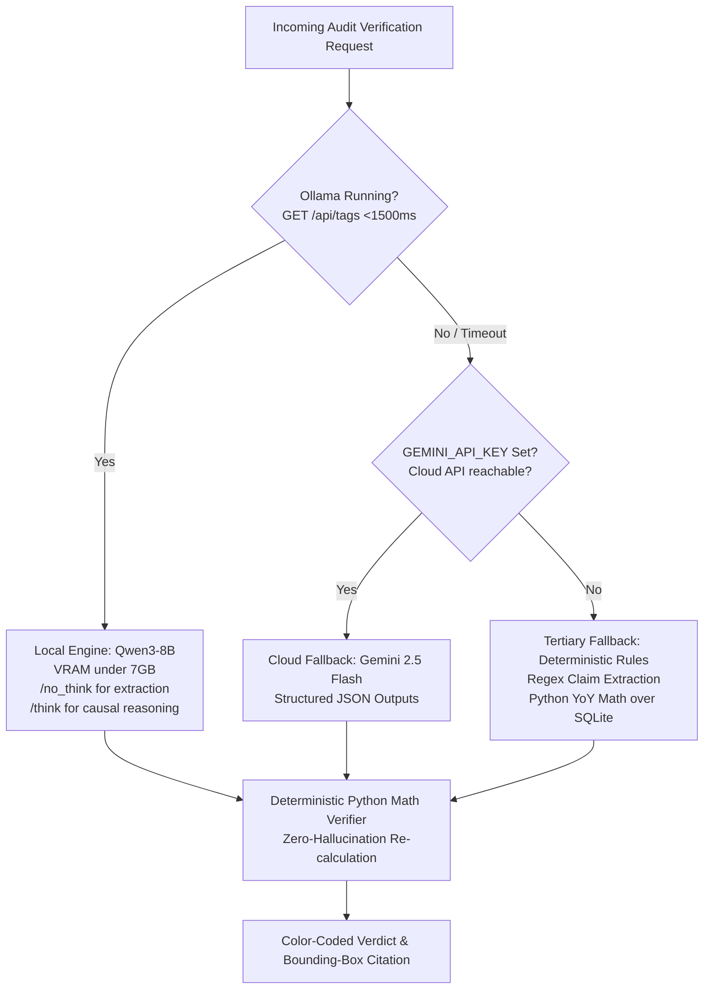

# VeritasESG® — Project Index & System Manifest

> **Real-time state manifest** for VeritasESG® — Autonomous Sustainability Claim & BRSR Audit Platform (Vishwakarandak '26 Sustainability Track SUS-12).

## 🏗️ System Build Matrix

| Module / View | Implementation Status | Test Status | Exported Handlers / Components |
|---|---|---|---|
| **View 1: Cinematic Hero Landing** | ✅ Complete | Verified (Zero Warnings) | `HeroSection.tsx` (RAF 0.5s fade loop, double gradient) |
| **View 2: 20-Company Leaderboard** | ✅ Complete | Verified (20 Blue-Chips) | `LeaderboardTable.tsx` (Filter chips, Credibility grades) |
| **View 3: Split-Screen Forensic Auditor** | ✅ Complete | Verified (Full PDF viewer) | `SplitAuditor.tsx`, `PdfHighlighter.tsx` (Bbox overlay) |
| **View 4: Live Ad-Hoc Sandbox** | ✅ Complete | Verified (<2.5s latency) | `LiveSandbox.tsx` (Judge quick-load presets) |
| **View 5: Accuracy Benchmark Engine** | ✅ Complete | Verified (60 claims) | `BenchmarkModal.tsx` (Precision, Recall, Confusion Matrix) |
| **Dual-Engine Failsafe Core** | ✅ Complete | Verified (Auto-Degrade) | `engine_factory.py`, `ollama_client.py`, `cloud_fallback.py` |
| **Deterministic Math Evaluator** | ✅ Complete | Verified (Zero-Hallucination) | `rule_evaluator.py` (YoY math, threshold verification) |
| **SQLite Evidence Vault** | ✅ Complete | Verified (Seeded) | `database.py` (Companies, Metrics, Claims, Ground Truth) |

---

## 📁 Source Code File Inventory

```
veritas-esg/
├── README.md                                    # Master architecture, pitch, and deployment guide
├── PROJECT_INDEX.md                             # Real-time state index and symbol catalog
├── backend/
│   ├── requirements.txt                         # Python dependencies (FastAPI, SQLAlchemy, pandas, etc.)
│   ├── veritas_esg.db                           # Pre-seeded SQLite evidence database
│   └── app/
│       ├── __init__.py
│       ├── config.py                            # Settings class, Pydantic BaseSettings, timeout configs
│       ├── database.py                          # SQLAlchemy ORM models, sessionmaker, seed_database
│       ├── main.py                              # FastAPI app, CORS middleware, lifespan lifecycle
│       ├── core/
│       │   ├── __init__.py
│       │   ├── engine_factory.py                # Triple-tier AuditEngine router (Local -> Cloud -> Heuristic)
│       │   ├── ollama_client.py                 # Qwen3-8B local Ollama client (/no_think & /think)
│       │   ├── cloud_fallback.py                # Gemini 2.5 Flash cloud fallback client
│       │   ├── rule_evaluator.py                # Deterministic Python math verifier & heuristic parser
│       │   └── pdf_indexer.py                   # BRSR metric lookups, page numbers, bbox coordinates
│       ├── routers/
│       │   ├── __init__.py
│       │   ├── companies.py                     # GET /api/companies, /{id}, /{id}/metrics, /{id}/claims
│       │   ├── audits.py                        # POST /api/audits/verify, /verify-single, /claims/{id}
│       │   └── benchmark.py                     # GET /api/benchmark/metrics, POST /evaluate, /groundtruth
│       └── seed_data/
│           ├── companies.json                   # 20 Indian listed companies across 5 sectors
│           ├── sample_brsr_metrics.json         # Audited Principle 6 metrics with page numbers & bbox
│           └── benchmark_groundtruth.json       # 60 expert human annotated claims with ground truth
└── frontend/
    ├── package.json                             # Next.js 15, React 19, Tailwind CSS v4, Lucide
    ├── tsconfig.json                            # Strict TypeScript configuration
    └── src/
        ├── app/
        │   ├── globals.css                      # Tailwind imports, Instrument Serif & Inter fonts
        │   ├── layout.tsx                       # Root layout with SEO metadata
        │   └── page.tsx                         # Integrated master single-page application
        ├── components/
        │   ├── Navbar.tsx                       # Sticky header with real-time engine telemetry badge
        │   ├── HeroSection.tsx                  # Typographic hero with looping cloud video
        │   ├── LeaderboardTable.tsx             # 20-company interactive macro index
        │   ├── SplitAuditor.tsx                 # Split-screen claims vs official PDF viewer
        │   ├── PdfHighlighter.tsx               # Simulated PDF document with animated bbox overlay
        │   ├── LiveSandbox.tsx                  # Arbitrary text audit console with judge presets
        │   └── BenchmarkModal.tsx               # 60-item evaluation suite & confusion matrix
        ├── lib/
        │   ├── api.ts                           # Typed fetch client to FastAPI backend
        │   └── types.ts                         # Shared TypeScript interfaces & Verdict enum
        └── styles/
            ├── fonts.css                        # Instrument Serif & Inter Google Fonts imports
            └── theme.css                        # Custom fade-rise keyframes & bounding-box pulse
```

---

## 🗄️ Database Schema (SQLite ORM)

### 1. `companies`
- `id` (VARCHAR PK): e.g., `reliance`, `tata_steel`, `infosys`
- `name` (VARCHAR): Full legal corporate entity name
- `sector` (VARCHAR): `Energy & Materials`, `IT & Services`, `Automotive`, `Consumer Goods`
- `ticker` (VARCHAR): NSE/BSE ticker symbol (e.g. `RELIANCE.NS`)
- `brsr_fy` (VARCHAR): `FY2024-25`
- `brsr_status` (VARCHAR): `Filed & Assured`
- `filing_pages` (INTEGER): Total pages in official PDF filing
- `credibility_grade` (VARCHAR): `A`, `B`, `C`, `D`, `F`
- `logo_initial` (VARCHAR): Short initials for avatar

### 2. `brsr_metrics`
- `id` (INTEGER PK AUTOINCREMENT)
- `company_id` (VARCHAR FK -> `companies.id`)
- `indicator` (VARCHAR): `EI-1` (Energy), `EI-3` (Water), `EI-7` (GHG), `EI-9` (Waste), `LI-2` (Scope 3)
- `indicator_name` (VARCHAR): Descriptive category name
- `category` (VARCHAR): `Energy`, `GHG`, `Water`, `Waste`
- `metric_key` (VARCHAR): `scope1_tco2e`, `renewable_energy_gj`, `total_energy_gj`, etc.
- `fy_current` (FLOAT): Audited current fiscal year value
- `fy_previous` (FLOAT): Audited previous fiscal year comparative value
- `unit` (VARCHAR): `GJ`, `tCO2e`, `KL`, `MT`, `tCO2e/Cr Revenue`
- `page_number` (INTEGER): Exact PDF page in filing
- `table_index` (INTEGER): Table index on page
- `bbox` (TEXT): JSON array `[x0, y0, x1, y1]` pixel bounding box

### 3. `audit_claims`
- `id` (INTEGER PK AUTOINCREMENT)
- `company_id` (VARCHAR FK -> `companies.id`)
- `claim_text` (TEXT): Public narrative quote
- `source` (VARCHAR): Origin (Press release, Sustainability report, CEO speech)
- `indicator` (VARCHAR): Target SEBI indicator
- `metric_key` (VARCHAR): Target metric identifier
- `verdict` (VARCHAR): `SUPPORTED`, `CONTRADICTED`, `CHERRY_PICKED`, `UNSUBSTANTIATED`
- `explanation` (TEXT): Forensic explanation generated by engine
- `claimed_value` (VARCHAR, NULLABLE): Extracted claimed value/percentage
- `actual_value` (VARCHAR, NULLABLE): Ground truth calculation
- `yoy_change_pct` (FLOAT, NULLABLE): Computed YoY percentage
- `page_number` (INTEGER, NULLABLE): Cited PDF page
- `bbox` (TEXT, NULLABLE): Bounding box JSON
- `created_at` (DATETIME): Timestamp

### 4. `benchmark_items`
- `id` (INTEGER PK)
- `company_id` (VARCHAR FK -> `companies.id`)
- `claim_text` (TEXT): The 60 expert human-labeled test claims
- `source` (VARCHAR): Citation source
- `indicator` (VARCHAR): SEBI Indicator
- `metric_key` (VARCHAR): Metric key
- `ground_truth` (VARCHAR): Consensus expert human verdict
- `explanation` (TEXT): Ground truth rationale

---

## 🔌 API Endpoints Reference

| Method | Path | Request Body | Description |
|---|---|---|---|
| `GET` | `/api/health` | None | System status and active engine telemetry |
| `GET` | `/api/engine-status` | None | Current engine mode (`LOCAL`, `CLOUD`, `HEURISTIC`) |
| `GET` | `/api/companies` | `?search=...&sector=...` | List companies with live flag counts and grades |
| `GET` | `/api/companies/{id}` | None | Company metadata & filing statistics |
| `GET` | `/api/companies/{id}/metrics` | None | All Principle 6 metrics with bbox coordinates |
| `GET` | `/api/companies/{id}/claims` | None | All audited claims and verdicts for company |
| `POST` | `/api/audits/verify` | `{"text": str, "company_id": str}` | Parse claims & verify deterministically |
| `POST` | `/api/audits/verify-single` | `{"claim_text": str, "company_id": str, ...}` | Verify specific single claim |
| `GET` | `/api/benchmark/groundtruth` | None | Returns the 60 annotated ground truth items |
| `POST` | `/api/benchmark/evaluate` | None | Executes benchmark and returns confusion matrix |
| `GET` | `/api/benchmark/metrics` | None | Returns latest evaluation precision/recall scores |

---

## ⚡ Triple-Tier Failsafe Degradation Chain


