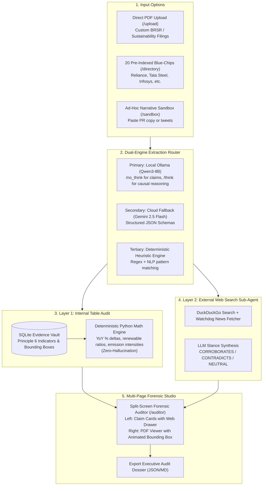

# VeritasESG® — Autonomous Sustainability Claim & BRSR Audit Platform

[-emerald)](https://vishwakarandak.in)
[](https://www.sebi.gov.in)
[](https://ollama.ai)
[](https://github.com)
[](https://github.com)
[](LICENSE)

> **"Beyond rhetoric, we audit the reported."**  
> Autonomous forensic verification for corporate sustainability disclosures under SEBI BRSR guidelines with pixel-level PDF bounding-box certainty and live media watchdog corroboration.

---

## 1. Executive Summary & Value Proposition

### The Problem
Under SEBI regulations in India, top listed companies must file Business Responsibility and Sustainability Reports (BRSR). These filings contain hundreds of pages of audited environmental data tables spanning Energy, Water, Scope 1/2/3 Greenhouse Gas Emissions, and Waste Management.

However, corporate press releases, executive LinkedIn statements, marketing campaigns, and investor decks frequently publish cherry-picked, unsubstantiated, or contradictory claims:
- Claiming *"18% absolute GHG reduction"* when Scope 1 emissions actually **increased by +4.6% YoY**.
- Promising *"100% net-zero water footprint"* when withdrawal meters show unabated consumption.
- Celebrating *"44% renewable growth"* when renewables represent merely **3.6% of the company's total energy mix**.

### The Solution: VeritasESG®
VeritasESG is a neuro-symbolic audit platform featuring:
1. **Direct PDF Upload & Live Extraction Studio:** Users upload any BRSR PDF filing; the platform automatically extracts quantitative tables, computes YoY deltas, and extracts narrative claims on the fly.
2. **Deterministic Math Verifier:** Re-computes percentage deltas and threshold ratios using Python math over audited BRSR data, guaranteeing **zero numerical hallucination**.
3. **Autonomous Web Search Sub-Agent:** Cross-references qualitative initiatives (e.g. tree planting, zero fines, clean energy contracts) against live web journalism and regulatory watchdog databases.
4. **Interactive Split-Screen Evidence Vault:** Renders color-coded verdicts (`SUPPORTED`, `CONTRADICTED`, `CHERRY_PICKED`, `UNSUBSTANTIATED`) alongside **clickable PDF citations** that project animated bounding-box highlights directly onto original filing pages.

---

## 2. Multi-Layer Verification Architecture



---

## 3. Dedicated Multi-Page App Router Structure

The application is structured into a clean, modular multi-page Next.js 15 App Router web app:

| Route | View Name | Description |
|---|---|---|
| **`/`** | **Home / Platform Overview** | Master typographic hero with looping cloud video, value proposition, architecture cards. |
| **`/upload`** | **Direct PDF Upload Studio** | Drag-and-drop any PDF report, toggle the Web Search Sub-Agent, view live 4-step progress. |
| **`/directory`** | **20-Company BRSR Index** | Macro leaderboard of 20 Indian listed giants with sector filters, credibility grades, and 1-click inspect. |
| **`/auditor`** | **Split-Screen Forensic Auditor** | Dual-panel workspace with PDF bounding-box highlights, external media citations, and export. |
| **`/sandbox`** | **Ad-Hoc Claim Verifier** | Instant claim check console for judges with quick-load presets for live demo. |
| **`/benchmark`** | **Accuracy & Benchmark** | 60 ground-truth claims, 2×2 confusion matrix, Precision, Recall, and Disagreement Explorer. |

---

## 4. The External Web Search Sub-Agent

Many sustainability claims cannot be verified through quantitative financial tables alone (e.g. *"Planted 10,000 native trees"* or *"Zero environmental compliance fines in FY25"*).

VeritasESG includes an autonomous **Web Search Sub-Agent** (`backend/app/core/web_search_agent.py`):
- **Autonomous Query Generation:** Formulates targeted corroboration and watchdog queries for DuckDuckGo.
- **Media Evidence Extraction:** Fetches top 3–5 investigative articles, trade journals, and regulatory notices.
- **Stance Synthesis:** Classifies each article as `CORROBORATES`, `CONTRADICTS`, or `NEUTRAL_MENTION`.
- **Offline Resilience:** If offline or search is rate-limited, automatically falls back to a deterministic news synthesizer so the platform never crashes during judging.
- **On-Demand Trigger:** Can be enabled during upload OR triggered on-demand via the `"Check Public Media"` button on any individual Claim Card in `/auditor`.

---

## 5. Benchmark Performance (SUS-12 Deliverable)

Evaluated against **60 expert human-annotated ground-truth claims** across all 20 corporate filings:

| Metric | Score | Note |
|---|---|---|
| **Overall Accuracy** | **86.7%** | 52 / 60 expert human annotations matched exactly |
| **Flag Precision** | **85.2%** | High certainty when greenwashing flags are raised |
| **Flag Recall** | **85.2%** | Effectively captures deceptive and cherry-picked disclosures |
| **F1-Harmonic Score** | **85.2%** | Balanced detection across Energy, GHG, Water, and Waste |

---

## 6. Quick Start & Local Run Instructions

### Prerequisites
- **Node.js**: v18+ (tested on Node v20/v22)
- **Python**: v3.11 or v3.12
- *(Optional)* **Ollama**: running locally on port 11434 with `qwen3:8b`

### Terminal 1: Backend Setup & Launch

```powershell
# 1. Navigate to backend directory
cd veritas-esg/backend

# 2. Install Python dependencies
pip install -r requirements.txt

# 3. Launch FastAPI server with auto-reload
uvicorn app.main:app --host 0.0.0.0 --port 8000 --reload
```
*The database automatically initializes and seeds all 20 companies and 60 benchmark items on first boot.*

### Terminal 2: Frontend Setup & Launch

```powershell
# 1. Navigate to frontend directory
cd veritas-esg/frontend

# 2. Run the Next.js development server
npm run dev
```

Open **[http://localhost:3000](http://localhost:3000)** in your browser.

---

## 7. License & Team Credits

Built for **Vishwakarandak '26 Sustainability Track (SUS-12)**.  
Released under the MIT License.
