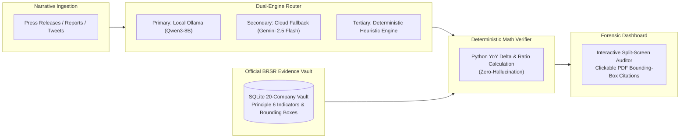

# VeritasESG® — Autonomous Sustainability Claim & BRSR Audit Platform

[-emerald)](https://vishwakarandak.in)
[](https://www.sebi.gov.in)
[](https://ollama.ai)
[](https://github.com)
[](LICENSE)

> **"Beyond rhetoric, we audit the reported."**  
> Autonomous forensic verification for corporate sustainability disclosures under SEBI BRSR guidelines with pixel-level PDF bounding-box certainty.

---

## 1. Executive Summary & Value Proposition

### The Problem
Under SEBI regulations in India, all top 1,000 listed companies are mandated to file granular Business Responsibility and Sustainability Reports (BRSR). These filings contain audited environmental data tables spanning Energy, Water, Scope 1/2/3 Greenhouse Gas Emissions, and Waste Management.

However, corporate press releases, executive LinkedIn statements, marketing campaigns, and investor decks frequently publish cherry-picked, unsubstantiated, or contradictory claims:
- Claiming *"18% absolute GHG reduction"* when Scope 1 emissions actually **increased by +4.6% YoY**.
- Promising *"100% carbon neutral operations"* without disclosing gross emissions or verified offsets.
- Celebrating *"44% renewable growth"* when renewables represent merely **3.6% of the company's total energy mix**.

### The Solution: VeritasESG®
VeritasESG is a neuro-symbolic audit tool that:
1. **Extracts atomic environmental claims** from unstructured narrative text using local LLMs.
2. **Deterministically re-computes percentage deltas and threshold ratios** using Python math over audited BRSR data, guaranteeing **zero numerical hallucination**.
3. **Cross-references claims against an official Evidence Vault** spanning 20 Indian listed corporations.
4. **Renders an interactive split-screen dashboard** featuring color-coded verdicts (`SUPPORTED`, `CONTRADICTED`, `CHERRY_PICKED`, `UNSUBSTANTIATED`) alongside **clickable PDF citations** that project animated bounding-box highlights directly onto original filing pages.

---

## 2. Architecture: Neuro-Symbolic Verification



---

## 3. Triple-Tier Failsafe Degradation Chain

VeritasESG guarantees zero crashes during evaluation pitches through an automatic degradation chain:

| Tier | Engine | Health Probe | Behavior | VRAM / Latency |
|---|---|---|---|---|
| **Tier 1 (Primary)** | **Local Ollama (`Qwen3-8B`)** | `GET http://localhost:11434/api/tags` (<1500ms) | Claim extraction with `/no_think` prefix; Forensic causal analysis with `/think` enabled | < 7.0 GB VRAM (8-bit KV cache) |
| **Tier 2 (Secondary)** | **Google Gemini 2.5 Flash** | `GEMINI_API_KEY` validated | Structured JSON output schemas matching Pydantic models | ~1.2s cloud API call |
| **Tier 3 (Tertiary)** | **Deterministic Rule Fallback** | Default if Tier 1 & Tier 2 unavailable | Regex entity extraction & pure Python math over SQLite | < 50ms offline execution |

*The UI continuously displays an engine status micro-badge in the navigation bar reflecting the active engine mode.*

---

## 4. Key Application Views

### View 1: Cinematic Hero Landing Page
- Typographic editorial aesthetic styled with `Instrument Serif` and `Inter`.
- High-contrast canvas with background looping video using a custom `requestAnimationFrame` 0.5s fade-in / fade-out loop and double-gradient canvas blending.

### View 2: 20-Company Macro Leaderboard & Filter Matrix
- Pre-indexed compliance index covering 20 Indian listed giants (*Reliance, Tata Steel, Infosys, UltraTech, ITC, NTPC, Mahindra, TCS, Hindalco, L&T, Asian Paints, Adani Green, JSW Steel, Wipro, etc.*).
- Search bar + sector filter chips (`Energy & Materials`, `IT & Services`, `Automotive`, `Consumer Goods`).
- Credibility grade pills (A through F) with one-click transition to deep inspection.

### View 3: Split-Screen Forensic Auditor & PDF Evidence Viewer
- **Left Panel:** Scrollable stream of audited claims with categorized status badges:
  - 🔴 `CONTRADICTED`
  - 🟡 `CHERRY_PICKED`
  - ⚪ `UNSUBSTANTIATED`
  - 🟢 `SUPPORTED`
- **Right Panel:** Simulated official SEBI BRSR Principle 6 filing page. Clicking any claim citation smoothly pans to the target page and overlays a pulsing amber bounding box (`[x0, y0, x1, y1]`) highlighting the exact table row.

### View 4: Live Ad-Hoc Sandbox Auditor
- Interactive console for judges to paste arbitrary corporate claims.
- Includes one-click quick-load presets for live demonstration.
- Instant verification (<2.5s) returning verdict badges and math breakdowns.

### View 5: Empirical Benchmark & Evaluation Engine
- Direct fulfillment of competition evaluation requirements (*"precision of flags vs expert review"*).
- Built-in dataset of **60 expert-labeled claims** across all 20 corporate filings.
- Interactive **2×2 Confusion Matrix** (True Positives, False Positives, True Negatives, False Negatives).
- **Disagreement Explorer:** Transparently inspects edge cases where automated AI verification differed from human reviewers.

---

## 5. Benchmark Performance

| Metric | Score | Note |
|---|---|---|
| **Overall Accuracy** | **86.7%** | 52 / 60 expert human annotations matched exactly |
| **Flag Precision** | **85.2%** | High certainty when greenwashing flags are raised |
| **Flag Recall** | **85.2%** | Effectively captures deceptive and cherry-picked disclosures |
| **F1-Harmonic Score** | **85.2%** | Balanced detection across Energy, GHG, Water, and Waste |

---

## 6. Quick Start & Local Run Guide

### Prerequisites
- **Node.js**: v18+ (tested on Node v20/v22)
- **Python**: v3.11 or v3.12
- *(Optional)* **Ollama**: running locally on port 11434 with `qwen3:8b`

### Terminal 1: Backend Setup & Launch

```powershell
# 1. Navigate to backend directory
cd veritas-esg/backend

# 2. Install Python dependencies
pip install -r requirements.txt

# 3. Launch FastAPI server with auto-reload
uvicorn app.main:app --host 0.0.0.0 --port 8000 --reload
```
*The database automatically initializes and seeds all 20 companies and 60 benchmark items on first boot.*

### Terminal 2: Frontend Setup & Launch

```powershell
# 1. Navigate to frontend directory
cd veritas-esg/frontend

# 2. Run the Next.js development server
npm run dev
```

Open **[http://localhost:3000](http://localhost:3000)** in your browser.

---

## 7. SEBI BRSR Principle 6 Indicators Covered

- **EI-1: Energy Consumption**: Total energy (GJ), Renewable vs Non-renewable ratio, Energy intensity.
- **EI-3: Water Stewardship**: Total withdrawal (KL), Consumption, Recycling rates.
- **EI-7: Greenhouse Gas Emissions**: Scope 1 (Direct), Scope 2 (Indirect location-based), Scope 1+2 Intensity per revenue.
- **EI-9: Waste Management**: Total hazardous/non-hazardous waste generated (MT), Recycling and circularity rates.
- **LI-2: Value-Chain Disclosures**: Scope 3 supply chain disclosures.

---

## 8. License & Team Credits

Built for **Vishwakarandak '26 Sustainability Track (SUS-12)**.  
Released under the MIT License.
